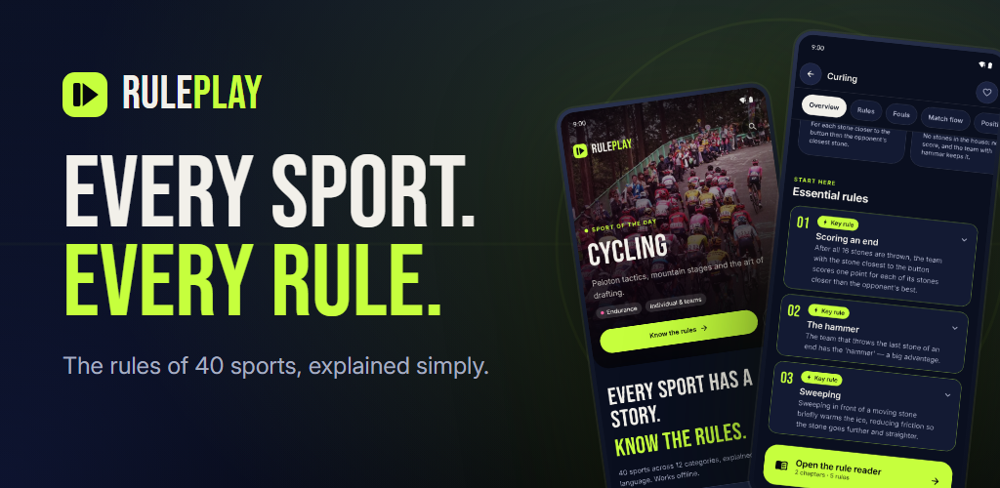
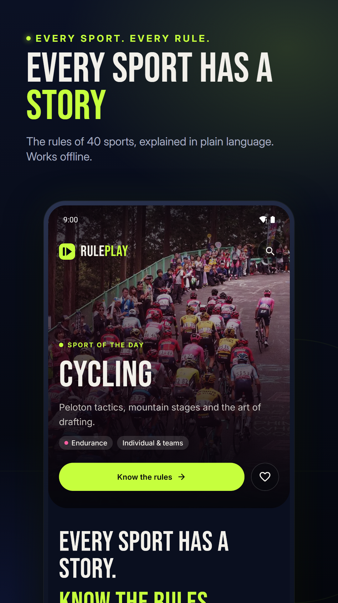
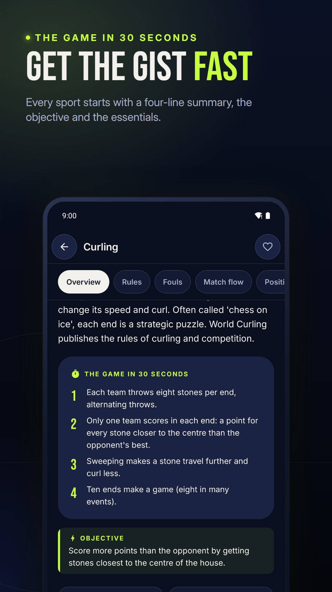
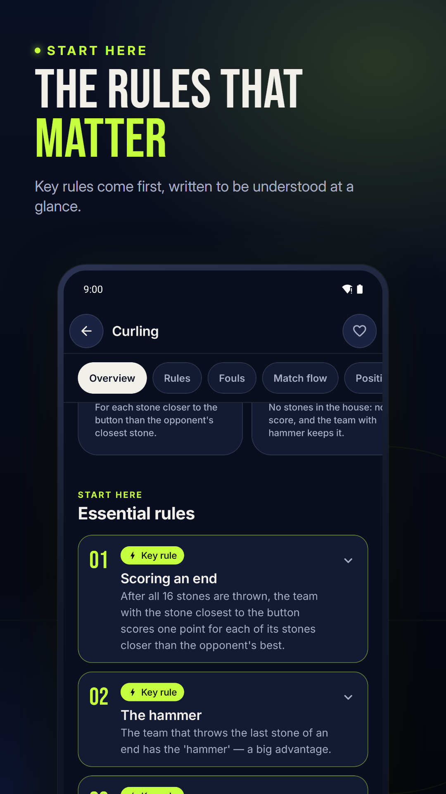
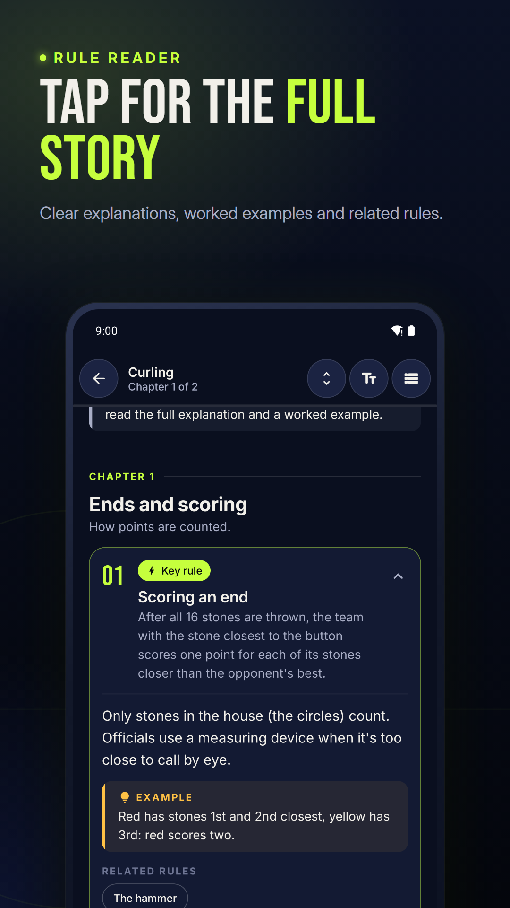
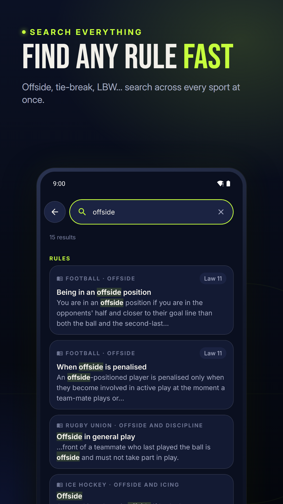
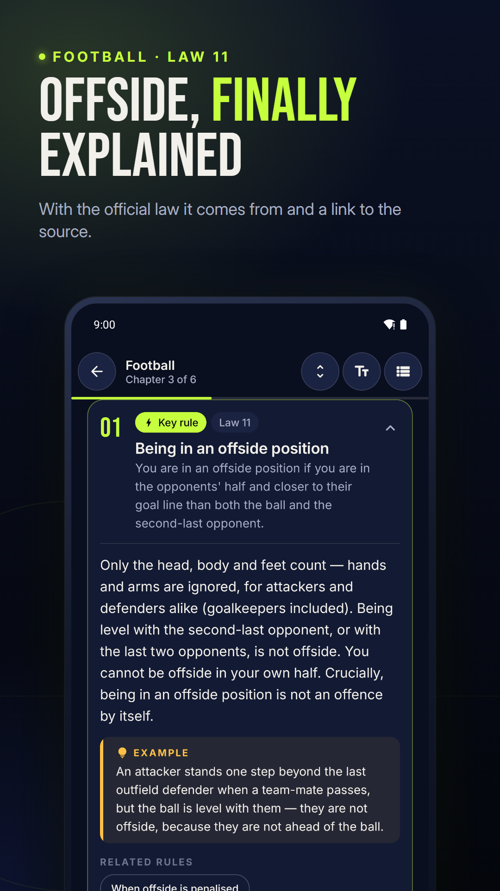
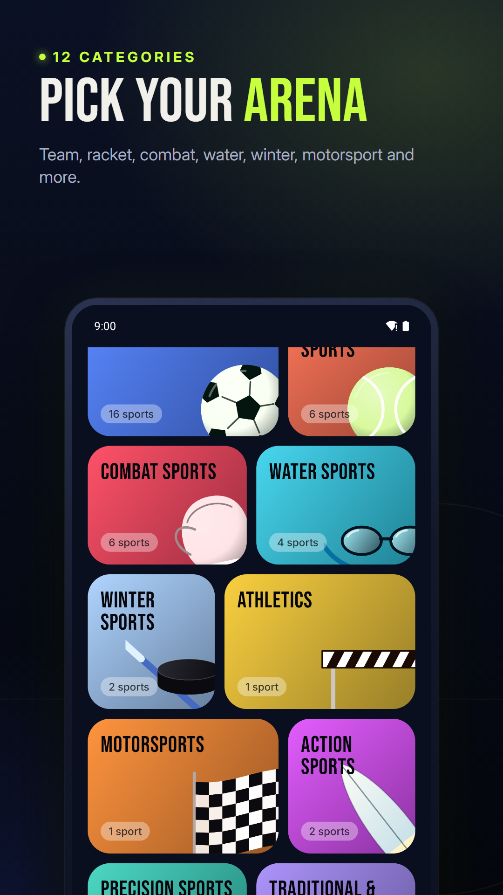
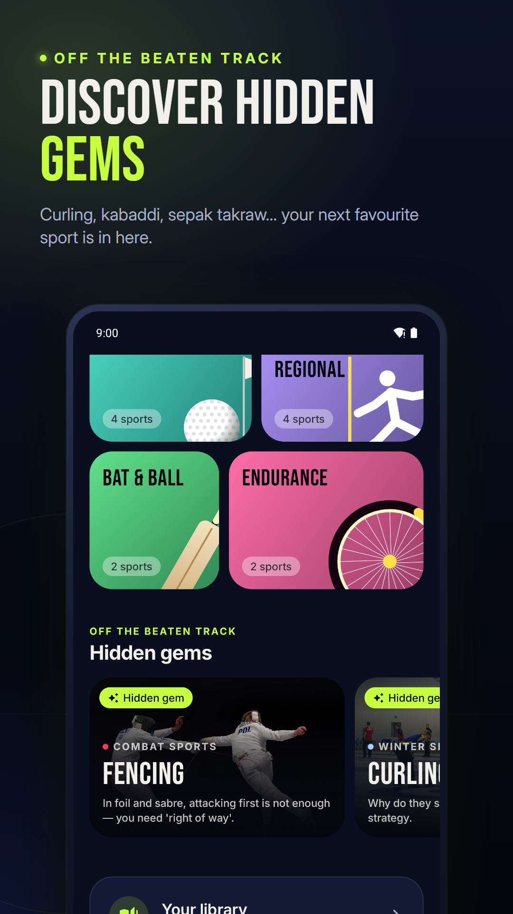

# RulePlay — The Ultimate Sports Rules Encyclopedia

A native Android encyclopedia of sports rules: 40 sports across 12 categories, explained in plain language, with a cover photo for every sport, a dedicated rule reader, local search, a personal library, and English/Spanish UI. Everything works offline.



## Screenshots

<table>
  <tr>
    <td></td>
    <td></td>
    <td></td>
    <td></td>
  </tr>
  <tr>
    <td></td>
    <td></td>
    <td></td>
    <td></td>
  </tr>
</table>

Spanish screenshots are in [`store/google-play/es/phone/`](store/google-play/es/phone/).

## Running it

1. Open the project folder in **Android Studio** (a recent version with AGP 9.3 support).
2. Let Gradle sync. The project uses the JDK bundled with Android Studio (JBR 21).
3. Choose a device or emulator running **Android 11 (API 30)** or newer, then click **Run ▶** on the `app` configuration.

From the command line (Windows, Git Bash):

```bash
export JAVA_HOME="/c/Program Files/Android/Android Studio/jbr"
./gradlew assembleDebug              # build
./gradlew testDebugUnitTest          # 52 unit tests (content integrity, search, filters, favorites, variants…)
./gradlew connectedDebugAndroidTest  # 4 Compose UI tests on a connected device/emulator
./gradlew assembleRelease            # R8-optimised release APK (unsigned)
```

> `connectedDebugAndroidTest` uninstalls the app once it finishes, which is normal Gradle behaviour.

## Stack

Kotlin 2.4 · Jetpack Compose (Material 3 underneath a custom design system) · Navigation Compose with type-safe routes · Koin · Coroutines/StateFlow · Room (favorites, history, recent searches) · DataStore (preferences) · kotlinx.serialization (bundled JSON content) · AppCompat per-app locales.

No network access or API keys are needed.

## Architecture

```
app/src/main/java/com/mutissx/ruleplay
├─ domain/        models, repository interfaces, use cases (search, filtering, discovery)
├─ data/          content/ (JSON DTOs, parser, bundled repository) · local/ (Room) · prefs/ (DataStore) · repository/
├─ core/designsystem/
│   ├─ theme/     colour tokens (dark + light), typography, spacing, shapes, motion (reduced-motion aware)
│   ├─ art/       original sport artwork engine: 25 playing-surface motifs × 39 equipment glyphs
│   └─ component/ SportHeroCard, FeaturedSportCard, SportCategoryChip, RuleSectionCard, RuleHighlight,
│                 RuleSearchBar, SportMetadataRow, RulePlayTopBar, RulePlayBottomBar, SaveToggle, EmptyState…
├─ feature/       discover · catalog (Explore) · sportdetail · rulereader · search · favorites (Library) · settings · onboarding
├─ navigation/    routes, nav host with shared-element transitions, app ViewModel, intro animation
└─ di/            Koin modules
```

Each screen has a stateless `XScreen` composable driven by an immutable UI state from its `XViewModel` (unidirectional data flow). Filters, selected variants and tabs live in `SavedStateHandle` so they survive configuration changes and process death.

## Content

Content is bundled in `app/src/main/assets/content/`:

- `catalog.json` — categories and the lightweight sports index (names, alternative names, Spanish translations, popularity, curated order, art spec, related sports).
- `sports/<id>.json` — one file per sport: overview, 30-second summary, facts, scoring, variants (e.g. FIBA/NBA, Test/ODI/T20, foil/épée/sabre), governing bodies, rulebooks, chapters → rules, fouls, match flow, positions, field, glossary, fun facts.
- Optional `sports/<lang>/<id>.json` translations; when missing, the app falls back to English and says so.

Adding a sport means adding a catalog entry and one JSON file — no UI code changes. `ContentIntegrityTest` validates every file and cross-reference on each build.

### Content integrity

- All rule text is an **editorial summary** written for RulePlay, and is labelled as such in the app. It is not official rulebook wording.
- Official numbering (e.g. "Law 11", "Rule 9", "Law 36") is only shown where it matches the published rulebook; otherwise no number is given.
- Each sport links to its governing body. On **14 October 2026** every link was requested over HTTP; links that responded successfully carry a "Link checked" date. Links that blocked automated checks (e.g. ITTF, IIHF, USA Pickleball) are shown as **"Link not verified"**, and bodies without a reachable site (IKF for kabaddi, ISTAF for sepak takraw) have no link. A checked link only means the page was reachable — not that each summary was verified line by line against it.
- Only one rulebook edition is stated (the NFL's 2026 rulebook, taken from the official URL). All others say "check the publisher for the current edition".
- Each sport's cover is an open-licensed photo from Wikimedia Commons (`assets/content/photos/`). Its credit is stored in `catalog.json` and shown in the app (sport detail › Sources, and Settings › Sources). Code-drawn original artwork is used as the fallback, and no federation imagery is used. Fonts (Bebas Neue, Inter) are under the SIL Open Font License; the licence texts are in `assets/licenses/`.

## Known limitations

- Rule content is English only; the Spanish UI shows English entries with a notice.
- The catalog has 40 sports; it does not claim to cover every sport.
- Rules change often. Summaries reflect the author's understanding as of October 2026 and should be checked against the linked official sources before competition use.
